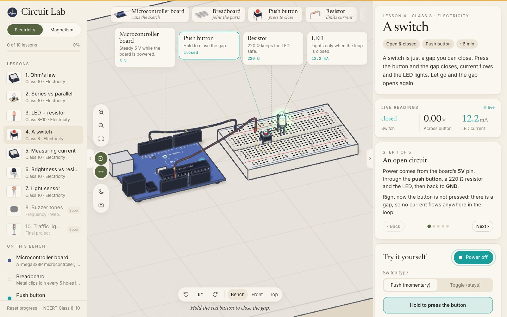
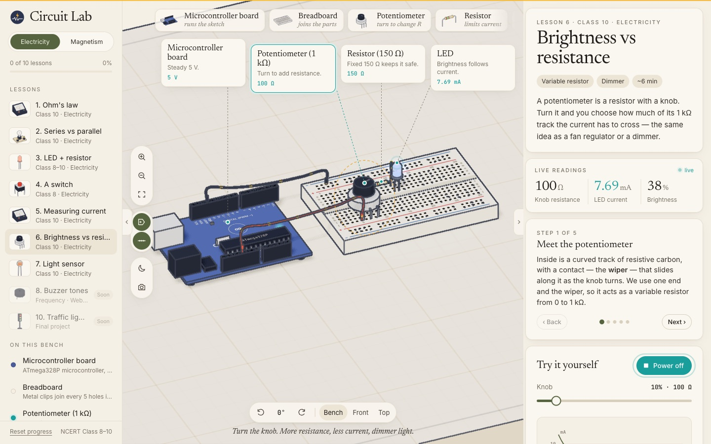
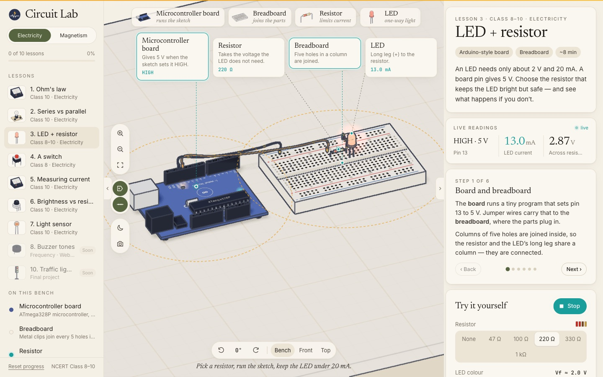
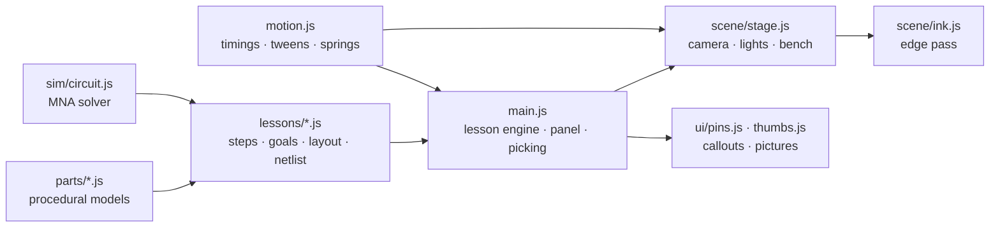

<div align="center">


# Circuit Lab

**Learn electricity on a 3D workbench — right in your browser.**

Build the circuits from NCERT Class 8–10 *Electricity* on an illustrated bench: close the key,
watch the needles swing and the charges flow, and read real values from a real circuit solver.
Seven lessons, from Ohm's law to a street light that switches itself on at dusk. No plugin, no backend.

[](https://threejs.org)
[](https://developer.mozilla.org/docs/Web/JavaScript)
[](https://vitejs.dev)
[](https://nodejs.org)
[](#-roadmap)
[](https://ncert.nic.in/textbook.php)

[Features](#-features) · [Quick start](#-quick-start) · [Shortcuts](#-keyboard--mouse) · [How it works](#-how-it-works) · [Project structure](#-project-structure) · [Roadmap](#-roadmap)

<br />

<picture>
  <source media="(prefers-color-scheme: dark)" srcset="docs/screenshots/overview-dark.jpg" />
  
</picture>

<sub>The hero image follows your GitHub theme — light or dark.</sub>

</div>

<br />

## ✦ Demo

<div align="center">

<br />
<sub>~36 seconds: build-in → Ohm's law → part card → series vs parallel → LED + resistor → burn-out · <a href="docs/demo.mp4">full-quality MP4</a></sub>
</div>

## ✦ At a glance

<table>
  <tr>
    <td align="center"><b>7</b><br /><sub>working lessons</sub></td>
    <td align="center"><b>14</b><br /><sub>procedural parts, no model files</sub></td>
    <td align="center"><b>MNA</b><br /><sub>real circuit solver</sub></td>
    <td align="center"><b>2</b><br /><sub>sketches that "run" line by line</sub></td>
    <td align="center"><b>0</b><br /><sub>servers or API keys</sub></td>
  </tr>
</table>

<table>
  <tr>
    <td width="50%"></td>
    <td width="50%"></td>
  </tr>
  <tr>
    <td align="center"><sub><b>Series vs parallel</b> — A₁ and A₂ always agree: current is not used up</sub></td>
    <td align="center"><sub><b>Burn-out</b> — no resistor, 300 mA, pop</sub></td>
  </tr>
  <tr>
    <td width="50%"></td>
    <td width="50%"></td>
  </tr>
  <tr>
    <td align="center"><sub><b>Light sensor</b> — dim the lamp, the street light comes on</sub></td>
    <td align="center"><sub><b>NCERT Activity 11.1</b> — readings table and a live V–I graph</sub></td>
  </tr>
</table>

## ✦ Features

**Lessons**
- **1 · Ohm's law** — 1 to 4 cells, a colour-banded resistor (10 / 15 / 22 / 47 Ω), ammeter in series,
  voltmeter across. Record readings; the V–I graph is a straight line whose slope is R.
- **2 · Series vs parallel** — two 6 V, 3 W torch bulbs. Rewire live, unscrew either bulb, compare two
  ammeters (going in, coming back).
- **3 · LED + resistor** — board, breadboard, LED and a resistor picker. Under ~75 Ω the LED burns out.
- **4 · A switch** — hold the push button to close the gap; an open switch has the full 5 V across it.
  Push (momentary) or toggle.
- **5 · Measuring current** — carry the ammeter to three places in one loop and read the same 0.20 A.
  Then the two classic mistakes: across the bulb, and wrong way round.
- **6 · Brightness vs resistance** — turn a 1 kΩ potentiometer and watch the LED dim along a live 1/R curve.
- **7 · Light sensor** — LDR voltage divider into A0, a sketch with a `limit`, a serial monitor, and a
  desk lamp you dim until the street light switches itself on.

**Learn**
- **Predict first** — every lesson asks for a guess before you run it, then explains the answer.
- **Steps that point** — each step rings the parts it talks about on the bench.
- **Goals** — a short checklist per lesson; completed lessons are saved in the browser.
- **Live circuit diagram** — NCERT symbols, drawn from the same values; live wires animate.
- **Sketch tab** — board lessons show their Arduino-style sketch and light each line as it "runs".

**Simulation — real values, not fakes**
- Modified nodal analysis over a netlist: cells, resistors, ammeters, switches, bulbs, LEDs.
- LEDs are piecewise: off below Vf, Vf + 10 Ω above it, re-solved until no LED changes state.
- Bulb glow follows electrical power (P = I²R) against its rating; LED brightness follows current.

**See**
- **Procedural parts** — microcontroller board, breadboard with instanced holes, LEDs, resistors with
  real colour bands, push button, potentiometer, LDR, buzzer, cells, ammeter, voltmeter, bulbs,
  plug key, desk lamp. All built in code.
- **Inked look** — cel shading plus a screen-space edge pass for outlines, an orthographic bench
  camera, soft shadows on the cream page.
- **Callouts** — cards tied to parts by leader lines; select a part and they fold into pills.
- **Moving charges** — dots ride the wires to show conventional current, faster for more current.

**Use anywhere**
- **Fold-away panels**, **light & dark themes**, **PNG snapshot**, **phone layout**.
- **Keyboard** pan and turn, **reduced motion** respected, **fallback** message without WebGL.

<table>
  <tr>
    <td width="33%"></td>
    <td width="33%"></td>
    <td width="33%"></td>
  </tr>
  <tr>
    <td align="center"><sub><b>Switch</b> — closed: 0 V across it</sub></td>
    <td align="center"><sub><b>Measuring current</b> — the classic mistake</sub></td>
    <td align="center"><sub><b>Brightness</b> — knob vs current</sub></td>
  </tr>
  <tr>
    <td width="33%"></td>
    <td width="33%"></td>
    <td width="33%"></td>
  </tr>
  <tr>
    <td align="center"><sub><b>Sketch</b> — the running line lights up</sub></td>
    <td align="center"><sub><b>Part card</b> — symbol and live facts</sub></td>
    <td align="center"><sub><b>LED + resistor</b> — 220 Ω, 13 mA</sub></td>
  </tr>
</table>

## ✦ Quick start

> **Requires** Node.js 18+ and npm.

```bash
git clone https://github.com/ImliStack/Circuit-Lab.git
cd Circuit-Lab
npm install
npm run dev        # → http://localhost:5182
```

Everything is generated in the browser — there are no models or data files to download.

| Script | What it does |
|---|---|
| `npm run dev` | Dev server with hot reload on port 5182 |
| `npm run build` | Static production build into `dist/` |
| `npm run preview` | Serve `dist/` locally on port 5182 |

## ✦ Using the lab

<details open>
<summary><b>Run a lesson</b></summary>
<br />

Pick a lesson on the left. The parts drop onto the bench, the wires draw themselves and the
callouts arrive. Read the steps on the right, answer the **Predict** question, then press **Run**
(or **Upload & run** / **Power on**) in *Try it yourself*. Change the controls while it runs — the
meters, the glow and the diagram follow at once. Finish the goals to mark the lesson done.

</details>

<details>
<summary><b>Inspect a part</b></summary>
<br />

Click any part on the bench, its callout, its quick-pick card along the top or its row under
*On this bench*. The camera eases in, the callouts fold into pills, a dashed ring marks the part,
and the panel shows what it does, its circuit symbol and its live numbers. **Zoom to it** gets
closer; **Back to the lesson** or <kbd>Esc</kbd> returns.

</details>

<details>
<summary><b>Work the hands-on parts</b></summary>
<br />

- **Push button** (lesson 4) — hold it on the bench with the mouse, or hold the big button in the panel.
- **Ammeter** (lesson 5) — choose a position and it is lifted to the new gap and re-wired.
- **Potentiometer** (lesson 6) — the *Knob* slider turns the knob on the bench.
- **Desk lamp** (lesson 7) — *Room light* dims the lamp and the whole bench with it.
- **Bulbs** (lesson 2) — unscrew and screw them back in from the panel.

</details>

<details>
<summary><b>Read the numbers</b></summary>
<br />

*Live readings* at the top of the panel show the lesson's three key values; they flash when they
change. The **circuit diagram** is drawn with NCERT symbols and the same values. Lesson 1 records
a readings table and plots V against I; lesson 5 records the current at each position.

</details>

## ✦ Keyboard & mouse

| Input | Action | | Input | Action |
|:---:|---|---|:---:|---|
| Drag | Pan the bench | | <kbd>W</kbd> <kbd>A</kbd> <kbd>S</kbd> <kbd>D</kbd> / arrows | Pan |
| Right-drag | Turn | | <kbd>Q</kbd> <kbd>E</kbd> | Turn 90° |
| Scroll / pinch | Zoom | | <kbd>R</kbd> | Reset the view |
| Click | Inspect a part | | <kbd>Esc</kbd> | Back to the lesson |
| Hold (button) | Press the push button | | <kbd>Space</kbd> | Hold-to-press button, when focused |

The view bar under the bench turns the camera in 90° steps and switches between *Bench*, *Front* and *Top*.

## ✦ How it works



| Piece | Approach |
|---|---|
| **Parts** | One class per part in `src/parts/`. Each builds its geometry from primitives, `LatheGeometry`, `ExtrudeGeometry` and `TubeGeometry`, exposes its terminals, a `tick()` for animation and live `facts()` for its card. Labels, dials, silkscreen and colour bands are `CanvasTexture`s. |
| **Solver** | Modified nodal analysis with Gaussian elimination: node voltages plus a current for every voltage-like element (cells, ammeters, closed switches, LEDs that are on). LED states are guessed, solved, checked and re-solved until stable. A tiny leak to ground keeps floating nodes solvable. |
| **Lessons** | Each lesson file places parts and wires, builds its netlist in `update()`, and returns its controls, callouts, diagram and (for board lessons) a sketch. The engine runs steps, predictions, goals and progress. |
| **Rendering** | Orthographic camera at a fixed bench angle, `MeshToonMaterial` with a three-step ramp, ACES tone mapping, one shadow light. Effects (glows, charge dots, labels) live on their own layer so they are never outlined or shadowed. |
| **Ink** | Normals and depth are rendered to a target; a full-screen shader marks silhouettes, depth steps and creases and is blended over the normal render. |
| **Wires** | `TubeGeometry` along a sagging `CatmullRomCurve3`. Draw-in grows the tube's draw range; instanced dots ride the curve at a speed set by the current. |
| **Callouts** | DOM cards over the canvas. Each frame anchors are projected, cards are packed into a row above or below the circuit, pills are pushed out and separated, and an SVG layer draws the leaders and rings. |
| **Thumbnails** | A small offscreen renderer with the same ink pass draws each part once for the lesson list and quick-pick cards. |
| **Motion** | Every duration lives in [`src/motion.js`](src/motion.js): a tween runner with `outBack` / `outCubic` / `inOutCubic`, damped springs for meter needles and the plug key, exponential damping for glows. Reduced motion snaps everything. |

## ✦ Project structure

```text
Circuit-Lab/
├── index.html                  App shell, fonts, meta tags, theme before first paint
├── package.json
├── vite.config.js              Relative base so the build runs from any folder
├── wrangler.jsonc              Cloudflare static-assets deploy
├── scripts/                    README screenshots + demo recording
├── PLAN.md                     Research notes, design decisions, milestones
├── docs/
│   ├── logo.svg
│   ├── demo.gif · demo.mp4     README demo
│   └── screenshots/            Images used in this README
├── public/
│   └── logo.svg                Favicon
└── src/
    ├── main.js                 Lesson engine, picking, panel, sidebar, tools, progress
    ├── motion.js               All timings, easings, springs, tween runner
    ├── style.css               Design tokens (light + dark), layout, components
    ├── scene/
    │   ├── stage.js            Renderer, orthographic camera, lights, bench, camera moves, keys
    │   ├── ink.js              Normal + depth pass and the edge shader
    │   ├── wire.js             Sagging tube wires, draw-in, charge dots
    │   └── label.js            Text decals and sprites
    ├── parts/
    │   ├── common.js           Toon materials, Part base class, binding posts, leads, glow
    │   ├── board.js            Microcontroller board, breadboard
    │   ├── passive.js          Resistor, LED, bulb, cell pack, plug key
    │   ├── meters.js           Ammeter and voltmeter
    │   └── extras.js           Push button, potentiometer, LDR, buzzer, desk lamp, tray
    ├── sim/
    │   ├── circuit.js          MNA circuit solver
    │   └── colorcode.js        Resistor colour bands
    ├── lessons/
    │   ├── index.js            Lesson list and thumbnails
    │   ├── kit.js              Shared helpers: placement, sketch, board runner, slider
    │   ├── ui.js               Segmented controls
    │   └── *.js                One file per lesson
    └── ui/
        ├── pins.js             Callout cards, pills, leaders, rings
        ├── thumbs.js           Offscreen inked thumbnails
        ├── schematic.js        NCERT circuit symbols in SVG
        └── info.js             What each part does
```

**Where to start reading:** [`src/lessons/ohm.js`](src/lessons/ohm.js) for a whole lesson,
[`src/sim/circuit.js`](src/sim/circuit.js) for the physics, [`src/main.js`](src/main.js) for the engine.

## ✦ Customising

| To… | Edit |
|---|---|
| Add a lesson | Copy [`src/lessons/ohm.js`](src/lessons/ohm.js), place parts with `ctx.add()`, wires with `ctx.wire()`, build the netlist in `update()`, list it in [`src/lessons/index.js`](src/lessons/index.js) |
| Add a part | Extend `Part` in [`src/parts/common.js`](src/parts/common.js); add its text to [`src/ui/info.js`](src/ui/info.js) |
| Change resistor choices | The value lists at the top of each lesson file |
| Retune an animation | The value in [`src/motion.js`](src/motion.js) — every move reads from there |
| Change the ink lines | `depthEdge`, `creaseEdge`, `ink` in [`src/scene/ink.js`](src/scene/ink.js) |
| Change theme colours | CSS custom properties at the top of [`src/style.css`](src/style.css) (`:root[data-theme='dark']` for dark) |

## ✦ Browser support & deployment

Works in current **Chrome, Edge, Firefox and Safari** on desktop and mobile; WebGL 2 must be
available (it is unless hardware acceleration is off). Device pixel ratio is capped at 2.


`npm run build` emits a fully static site in `dist/` — deploy it to **Cloudflare (Pages or
Workers), Vercel, Netlify or GitHub Pages** with no server and no environment variables. On
Cloudflare Workers Builds, [`wrangler.jsonc`](wrangler.jsonc) serves `dist/` as static assets
(build: `npm run build`, deploy: `npx wrangler deploy`). The build uses a relative base, so it
also works from a sub-folder.

<br clear="right" />

## ✦ FAQ

<details>
<summary><b>Are the numbers real?</b></summary>
<br />
Yes. Every reading comes from solving the circuit on the bench. The models are textbook-ideal:
cells have no internal resistance, ammeters none, voltmeters infinite; LEDs use a forward voltage
plus a 10 Ω dynamic resistance; the LDR goes from 1 MΩ in the dark to 1 kΩ in bright light.
</details>

<details>
<summary><b>Which way do the dots move?</b></summary>
<br />
They show conventional current, from + to −. Real electrons drift the other way, and far more slowly.
</details>

<details>
<summary><b>Is the board a real Arduino?</b></summary>
<br />
It is an Arduino-style board drawn in code. The sketches are shown and stepped through line by line
to explain what the board does; they are not compiled or executed.
</details>

<details>
<summary><b>Where is my progress saved?</b></summary>
<br />
In this browser only (<code>localStorage</code>). Private windows start fresh; <i>Reset progress</i> clears it.
</details>

<details>
<summary><b>Why no 3D on my machine?</b></summary>
<br />
Your browser has WebGL switched off — usually hardware acceleration is disabled. The page tells
you so instead of showing a blank bench.
</details>

## ✦ Roadmap

- [x] Ohm's law, series vs parallel, LED + resistor
- [x] Switch, measuring current, brightness (potentiometer), light sensor (LDR)
- [x] Real circuit solver, readings table, V–I graph, LED burn-out
- [x] Inked 3D bench, callouts, drop-in motion, sketch line trace, serial monitor
- [x] Dark theme, fold-away panels, phone layout, snapshot
- [ ] Lesson 8 · Buzzer tones — piezo buzzer driven by `tone()`, pitch from a Web Audio `OscillatorNode`
- [ ] Lesson 9 · Electromagnet — coil on an iron nail, compass deflection, field lines, turns vs strength
- [ ] Lesson 10 · Traffic light — final project: three LEDs, a timed sketch, a pedestrian button
- [ ] UI polish pass across all lessons: shorter callout titles, lighter step highlights, tablet layout
  (sidebar + panel squeeze the bench at ~1024 px), dark-mode bench colours, panel section spacing
- [ ] Phone pass: callout pills overlapping on small screens, bench height, controls reachable one-handed
- [ ] Re-record the README demo with lessons 4–7
- [ ] Free build mode, shareable circuits

Research notes and earlier milestones are in [PLAN.md](PLAN.md).

## ✦ Screenshots & demo

Every image and the demo in this README are generated from the running app:

```bash
npm run dev                    # keep running on :5182
scripts/readme-shots.sh        # refreshes docs/screenshots/*.jpg
scripts/readme-video.sh        # records docs/demo.mp4 + docs/demo.gif (needs ffmpeg)
```

Both use the gstack `browse` CLI in headed mode (WebGL needs a real GPU). For an inline video
player instead of the GIF, drag `docs/demo.mp4` into the README in GitHub's web editor — GitHub
hosts it and plays it in place.

## ✦ Contributing

Issues and pull requests are welcome.

1. Fork the repo and create a branch: `git checkout -b feature/your-idea`
2. Run `npm run dev` and make your change
3. Check `npm run build` passes
4. Open a pull request describing what changed and why

## ✦ Credits

| Source | What | Licence |
|---|---|---|
| [NCERT Science, Class 10, Ch. 11](https://ncert.nic.in/textbook.php) | Lesson content, Activity 11.1, circuit symbols | Educational reference |
| [PhET Interactive Simulations](https://phet.colorado.edu) (CU Boulder), Tinkercad Circuits, Brilliant | Learning-design research | — |
| [learn-arduino-red.vercel.app](https://learn-arduino-red.vercel.app) (design by Dilum Sanjaya) | Visual and motion direction studied; all code and models here are original | — |
| [three.js](https://threejs.org), [Vite](https://vitejs.dev) | 3D rendering, build | MIT |
| Google Fonts | Newsreader, Inter, JetBrains Mono | OFL |

> [!IMPORTANT]
> **Educational use only.** Circuit Lab simulates ideal components. Real circuits — and especially
> mains electricity — can hurt you; build them only with a teacher or a qualified adult.

<div align="center">
<br />
<sub>Made with care by <a href="https://github.com/ImliStack">ImliStack</a></sub>
</div>
