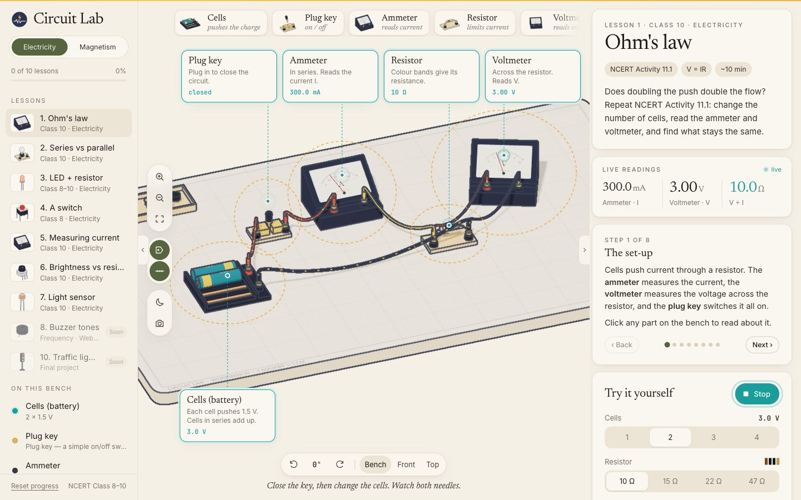
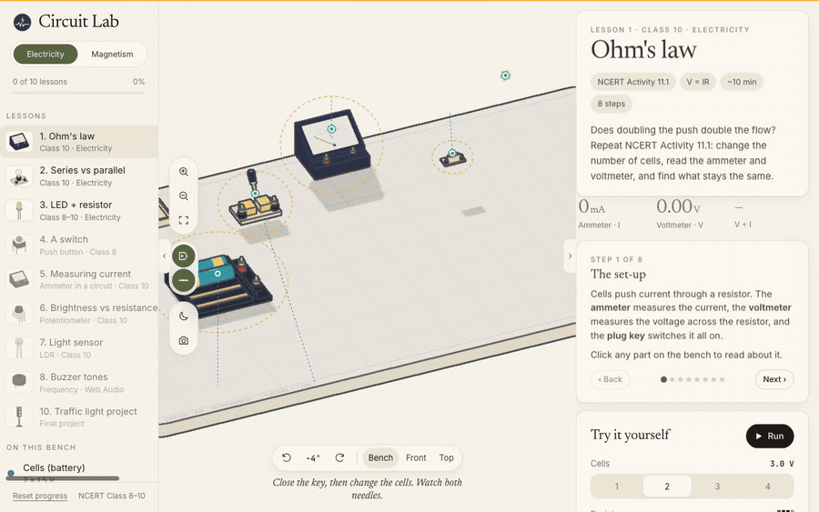
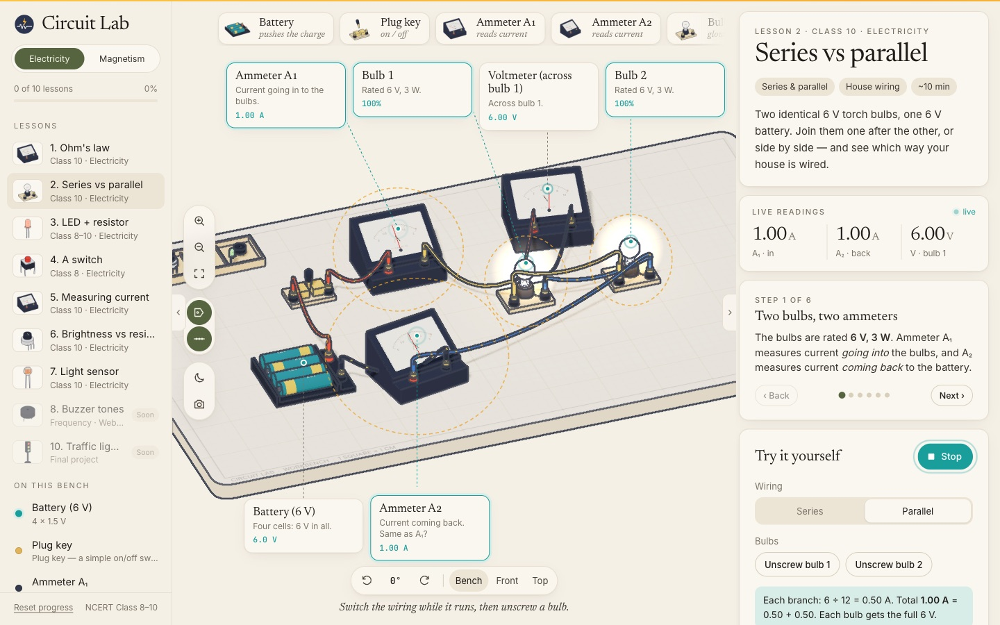
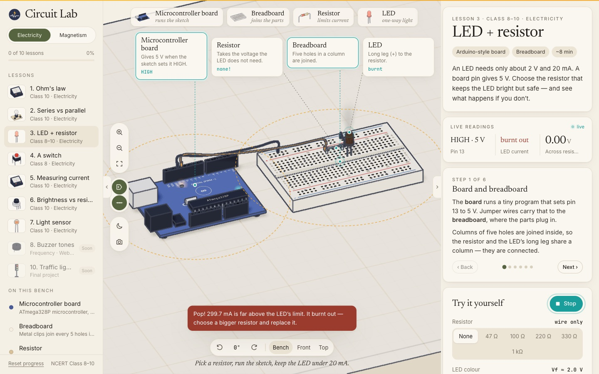
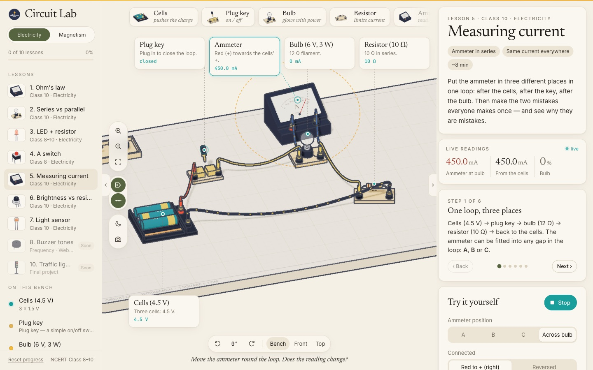
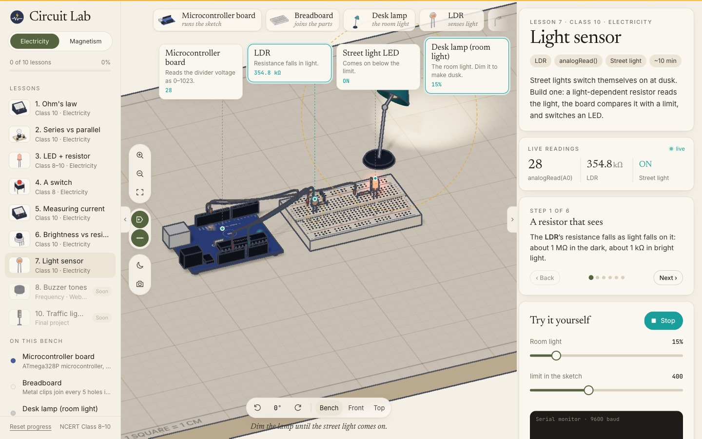
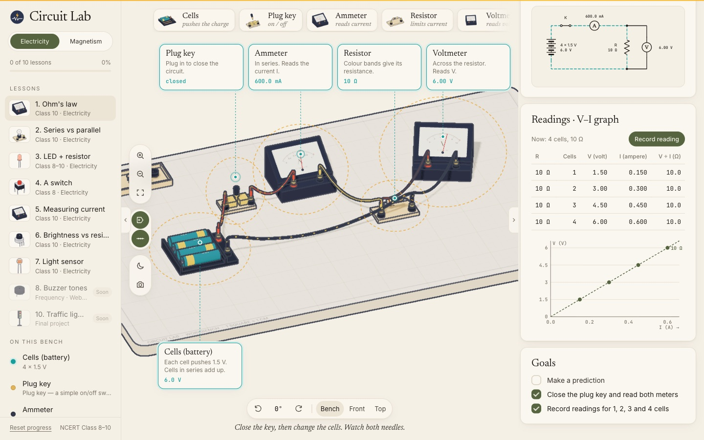
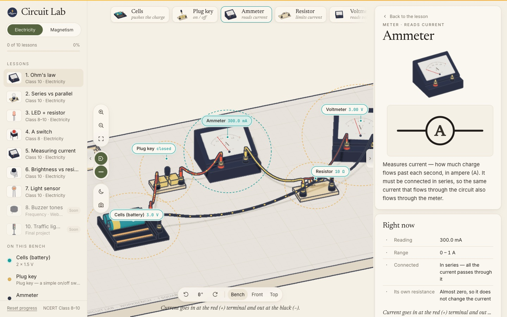
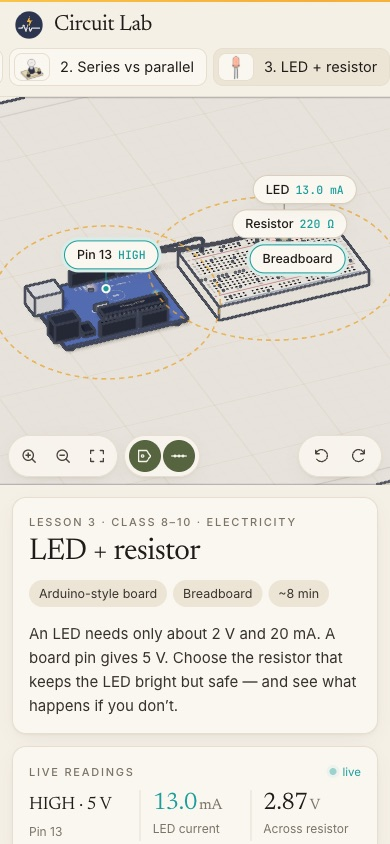

<div align="center">


# Circuit Lab

**Learn electricity on a 3D workbench, right in your browser.**

Build the circuits from NCERT Class 8–10 *Electricity* and *Magnetic Effects of Current* on an
illustrated bench. Close the key, watch the needles swing and the charges flow, and read real
values from a real circuit solver. No install, no plugin, no backend.

[](https://threejs.org)
[](https://developer.mozilla.org/docs/Web/JavaScript)
[](https://vitejs.dev)
[](https://nodejs.org)
[](https://ncert.nic.in/textbook.php)

[Features](#-features) · [Quick start](#-quick-start) · [Controls](#-controls) · [How it works](#-how-it-works) · [Project structure](#-project-structure) · [Roadmap](#-roadmap)

<br />

<picture>
  <source media="(prefers-color-scheme: dark)" srcset="docs/screenshots/overview-dark.jpg" />
  
</picture>

<sub>The hero image follows your GitHub theme — light or dark.</sub>

</div>

<br />

## ✦ Demo

<div align="center">

<br />
<sub>36 seconds: Ohm's law → part card → series vs parallel → LED + resistor → burn-out · <a href="docs/demo.mp4">full-quality MP4</a></sub>
</div>

## ✦ At a glance

<table>
  <tr>
    <td align="center"><b>10</b><br /><sub>lessons planned</sub></td>
    <td align="center"><b>7</b><br /><sub>fully working now</sub></td>
    <td align="center"><b>14</b><br /><sub>procedural parts, no model files</sub></td>
    <td align="center"><b>MNA</b><br /><sub>real circuit solver</sub></td>
    <td align="center"><b>0</b><br /><sub>servers or API keys</sub></td>
  </tr>
</table>

<table>
  <tr>
    <td width="50%"></td>
    <td width="50%"></td>
  </tr>
  <tr>
    <td align="center"><sub><b>Series vs parallel</b> — A₁ and A₂ always agree: current is not used up</sub></td>
    <td align="center"><sub><b>Burn-out</b> — no resistor, 300 mA, pop</sub></td>
  </tr>
  <tr>
    <td width="50%"></td>
    <td width="50%"></td>
  </tr>
  <tr>
    <td align="center"><sub><b>Measuring current</b> — the ammeter across the bulb short-circuits it</sub></td>
    <td align="center"><sub><b>Light sensor</b> — dim the lamp, the street light comes on</sub></td>
  </tr>
  <tr>
    <td width="50%"></td>
    <td width="50%"></td>
  </tr>
  <tr>
    <td align="center"><sub><b>NCERT Activity 11.1</b> — readings table and a live V–I graph</sub></td>
    <td align="center"><sub><b>Click any part</b> — what it does, its symbol and live numbers</sub></td>
  </tr>
</table>

## ✦ Features

**Lessons**
- **1 · Ohm's law** — 1 to 4 cells, a colour-banded resistor (10 / 15 / 22 / 47 Ω), ammeter in series,
  voltmeter across. Record readings into a table; the V–I graph draws a straight line whose slope is R.
- **2 · Series vs parallel** — two 6 V, 3 W torch bulbs. Rewire live, unscrew either bulb, and compare
  two ammeters (going in, coming back) to see that current is not used up.
- **3 · LED + resistor** — a microcontroller board, a breadboard, an LED and a resistor picker.
  Upload the sketch and watch each line light up as it "runs". Under ~75 Ω the LED burns out.
- **4 · A switch** — hold the push button (on the bench or in the panel) to close the gap. The full
  5 V sits across an open switch; try a toggle switch that stays where you leave it.
- **5 · Measuring current** — carry the ammeter to three places in one loop and read the same 0.20 A
  each time. Then the two classic mistakes: across the bulb (it goes dark, 0.45 A) and wrong way round.
- **6 · Brightness vs resistance** — turn a 1 kΩ potentiometer and watch the LED dim along a live
  1/R curve; a fixed 150 Ω keeps it safe at zero.
- **7 · Light sensor** — an LDR voltage divider into A0, a sketch with a `limit`, a serial monitor,
  and a desk lamp you dim until the "street light" switches itself on. The whole bench darkens with it.
- **8–10** — buzzer tones (Web Audio), electromagnet, traffic-light project. Shown as *Soon*.

**Learning design** (from PhET, Brilliant and physics-education research — see [PLAN.md](PLAN.md))
- **Predict first** — each lesson asks for a guess before you run it, then explains the answer.
- **Steps that point** — each step highlights the parts it talks about on the bench.
- **Goals** — a short checklist per lesson; finishing it is saved in `localStorage`.
- **Few controls** — two or three per lesson, never a free-for-all parts bin.

**Simulation — real values, not fakes**
- Modified nodal analysis over a netlist: cells, resistors, ammeters, switches, bulbs, LEDs.
- LEDs are piecewise: off below Vf, Vf + 10 Ω above it, solved until no LED changes state.
- Bulb glow follows electrical power (P = I²R) against its rating; LED brightness follows current.
- The circuit diagram is drawn from the same values and its live wires animate.

**3D bench**
- Every part is built in code: microcontroller board (headers, DIP chip, silkscreen), breadboard with
  instanced holes, LEDs, resistors with real colour bands, push button, potentiometer, LDR, buzzer,
  cell pack, ammeter and voltmeter with printed dials, torch bulbs, plug key, desk lamp.
- **Inked look** — cel shading plus a screen-space edge pass (depth + normals) for outlines,
  orthographic bench camera, soft shadows on the cream page.
- **Wires** are tubes along sagging Catmull–Rom curves; dots ride them to show conventional current.
- **Labels** — callout cards with leader lines; select a part and they fold into pills.

**Motion** (all timings in [`src/motion.js`](src/motion.js))
- Parts drop onto the bench and pop to size one after another; wires draw themselves end to end.
- Meter needles are springs: they overshoot a little and settle, like a moving-coil meter.
- Parts lift when you hover them; the plug key snaps in; lamps warm up and cool down.
- Changed numbers flash, new table rows pulse, finished lessons celebrate.
- Respects *reduced motion*: everything snaps instead.

**Interface** — the Body Atlas / SunPlot layout: lessons on the left, the bench in the middle with
quick-pick part cards, a tool column and a view bar, and the lesson panel on the right. Dark theme,
collapsible side panels, PNG snapshot, and a phone layout with the bench on top.

## ✦ Quick start

```bash
git clone <this repo> circuit-lab && cd circuit-lab
npm install
npm run dev          # http://localhost:5182
```

```bash
npm run build        # static site in dist/
npm run preview      # serve dist/ on :5182
```

Needs Node 18 or newer and a browser with WebGL 2.

## ✦ Controls

| Action | Mouse / touch | Keys |
|---|---|---|
| Pan the bench | drag · one finger | `W` `A` `S` `D` / arrows |
| Turn | right-drag · two fingers | `Q` / `E` (90° steps) |
| Zoom | scroll · pinch | toolbar `+` / `−` |
| Reset the view | toolbar ⛶ | `R` |
| Inspect a part | click it, or its label or card | `Esc` to close |

## ✦ How it works

| Piece | File | What it does |
|---|---|---|
| Stage | [`src/scene/stage.js`](src/scene/stage.js) | Renderer, orthographic camera, lights, bench, tweened camera moves, keyboard pan |
| Ink | [`src/scene/ink.js`](src/scene/ink.js) | Normals + depth pass, then an edge shader blended over the frame |
| Parts | [`src/parts/`](src/parts) | One class per part; each exposes terminals, `tick()` and live `facts()` |
| Wires | [`src/scene/wire.js`](src/scene/wire.js) | Sagging tube, draw-in, charge dots |
| Solver | [`src/sim/circuit.js`](src/sim/circuit.js) | MNA with Gaussian elimination and LED state iteration |
| Lessons | [`src/lessons/`](src/lessons) | Steps, goals, layout, netlist, controls, diagram and sketch per lesson |
| Labels | [`src/ui/pins.js`](src/ui/pins.js) | Callout cards / pills, leader lines, rings around parts |
| Pictures | [`src/ui/thumbs.js`](src/ui/thumbs.js) | Offscreen renderer that draws the inked part thumbnails |
| Motion | [`src/motion.js`](src/motion.js) | Every timing, easings, springs, tween runner |

Visual direction and research notes: [PLAN.md](PLAN.md).

## ✦ Project structure

```
src/
  main.js            app shell: lessons, picking, panel, sidebar, tools
  motion.js          timings, easing, spring, tweens
  style.css          tokens (light + dark) and layout
  scene/             stage, ink pass, wires, text decals
  parts/             board, breadboard, passive parts, meters, extras
  sim/               circuit solver, resistor colour code
  lessons/           one file per lesson + index
  ui/                pins, thumbnails, schematic symbols, part info
scripts/             README screenshots and demo recording
docs/                logo, screenshots, demo
```

### Add a lesson

1. Copy [`src/lessons/ohm.js`](src/lessons/ohm.js) to a new file.
2. Place parts with `ctx.add(...)` and wires with `ctx.wire(a, b)`.
3. Build the netlist in `update()` with `new Circuit()` and push readings with `ctx.hud(...)`.
4. List it in [`src/lessons/index.js`](src/lessons/index.js).

## ✦ Browser support & deployment

Works in current **Chrome, Edge, Firefox and Safari** on desktop and mobile; WebGL 2 must be available.



`npm run build` emits a fully static site in `dist/` — deploy it to **Cloudflare (Pages or Workers),
Vercel, Netlify or GitHub Pages** with no server and no environment variables. On Cloudflare
Workers Builds, [`wrangler.jsonc`](wrangler.jsonc) serves `dist/` as static assets
(build: `npm run build`, deploy: `npx wrangler deploy`).

<br clear="right" />

## ✦ FAQ

<details>
<summary><b>Are the numbers real?</b></summary>
<br />
Yes. Every reading comes from solving the circuit on the bench. The models are textbook-ideal:
cells have no internal resistance, ammeters none, voltmeters infinite; LEDs use a forward voltage plus a
10 Ω dynamic resistance.
</details>

<details>
<summary><b>Which way do the dots move?</b></summary>
<br />
They show conventional current, from + to −. Real electrons drift the other way, and far more slowly.
</details>

<details>
<summary><b>Where is my progress saved?</b></summary>
<br />
In this browser only (<code>localStorage</code>). Private windows start fresh. <i>Reset progress</i> clears it.
</details>

## ✦ Roadmap

- [x] Ohm's law, series vs parallel, LED + resistor
- [x] Switch, measuring current, brightness (potentiometer), light sensor (LDR)
- [x] Real circuit solver, readings table, V–I graph, LED burn-out
- [x] Inked 3D bench, callouts, drop-in motion, sketch line trace
- [x] Dark theme, phone layout, snapshot
- [ ] Lesson 8 · Buzzer tones — piezo buzzer driven by `tone()`, pitch from a Web Audio `OscillatorNode`
- [ ] Lesson 9 · Electromagnet — coil on an iron nail, compass deflection, field lines, turns vs strength
- [ ] Lesson 10 · Traffic light — final project: three LEDs, a timed sketch, a pedestrian button
- [ ] UI polish pass across all lessons: shorter callout titles, lighter step highlights, tablet layout
  (sidebar + panel squeeze the bench at ~1024 px), dark-mode bench colours, panel section spacing
- [ ] Phone pass: callout pills overlapping on small screens, bench height, controls reachable one-handed
- [ ] Re-record the README demo with lessons 4–7
- [ ] Free build mode, shareable circuits

## ✦ Screenshots & demo

Every image and the demo in this README are generated from the running app:

```bash
npm run dev                    # keep running on :5182
scripts/readme-shots.sh        # refreshes docs/screenshots/*.jpg
scripts/readme-video.sh        # records docs/demo.mp4 + docs/demo.gif (needs ffmpeg)
```

Both use the gstack `browse` CLI in headed mode (WebGL needs a real GPU). Re-run them before each
push that adds features, so the README always shows the current app.

## ✦ Contributing

1. Fork the repo and create a branch: `git checkout -b feature/your-idea`
2. Run `npm run dev` and make your change
3. Check `npm run build` passes
4. Open a pull request describing what changed and why

## ✦ Credits

Design research: PhET Interactive Simulations (CU Boulder), Tinkercad Circuits, Brilliant, NCERT
Class 10 Science Ch. 11. Visual and motion direction studied from
[learn-arduino-red.vercel.app](https://learn-arduino-red.vercel.app) (design by Dilum Sanjaya);
all code and models here are written from scratch.
